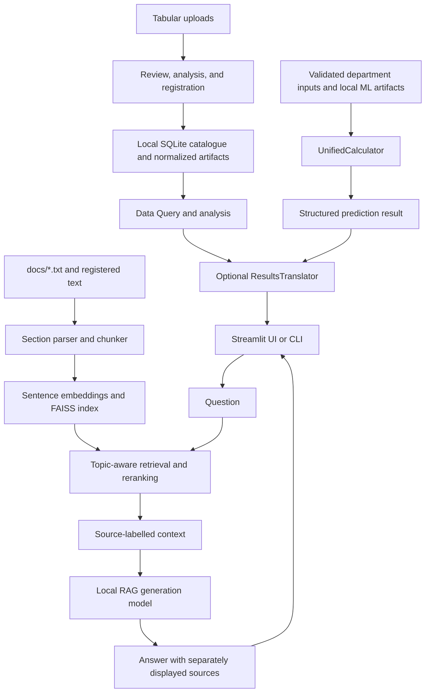

# PARSE — Process, Analysis, Retrieval, Synthesis & Evaluation

PARSE is a modular data and decision-support platform for metallurgical and
related industrial operations. It brings together local technical-document
retrieval, structured dataset analysis, and department-specific machine-learning
(ML) predictions. It is intended to help developers, researchers, and technical
users explore available evidence and datasets; it is a prototype, not an
industrial control system.

The Large Language Model (LLM) components explain retrieved or structured
evidence. They are not the numerical prediction engine. Predictions come from
separate trained ML artifacts and are limited by their training data and
validation.

## Key capabilities

### Data processing and analysis

- Stage `.txt`, `.csv`, `.xlsx`, `.xls`, `.json`, and `.jsonl` uploads for
  review before explicit registration.
- Run exploratory and structured analysis on registered tabular data. Cleaning
  proposals require approval; the original upload is retained.
- Store source metadata in a local SQLite catalogue and keep original and
  normalized artifacts separately.
- Index registered text documents for retrieval. Tabular registration does not
  automatically make a dataset training data.

### Technical information retrieval

- Split the available technical text into topic- and section-labelled chunks,
  embed them, and rank them with FAISS similarity search and section reranking.
- Use Retrieval-Augmented Generation (RAG) to provide retrieved passages as
  context to a local generation model.
- Show retrieved source files separately from the generated answer in the UI
  and CLI.

The checked-in knowledge corpus is focused on blast-furnace topics. Retrieval
only searches the available documents; it does not represent all metallurgical
knowledge.

### LLM-based explanation

- Translate structured analysis findings and prediction results into
  natural-language explanations.
- Apply numerical, causal-language, limitation, recommendation, and
  metric-semantics checks. When the model is disabled, unavailable, or fails
  hard checks, the system uses a deterministic fallback.
- The explainer is a presentation layer. It does not calculate predictions or
  establish that a finding is scientifically correct.

### Machine-learning prediction

| Department | Prediction target | Inputs and scope |
|---|---|---|
| Blast furnace | Softening temperature (`Ts`), melting temperature (`Tm`), and `Tm-Ts` in °C | Chemistry plus optional gas-atmosphere, burden-mix, and test-type inputs |
| Sintering | Sinter productivity in `T/m²-hr` | Eight prospective raw-mix chemistry and crushing-index features |
| Energy | Contemporaneous `Usage_kWh` | Reactive-power, power-factor, time-of-day, and calendar/load-type inputs |

The energy task estimates load for the supplied time interval; it is not a
multi-step future forecast. The tasks use independent datasets and models;
performance in one department does not establish performance in another.

### Application interface

- Streamlit UI with **RAG Chat**, **Predictor**, **Data Query**, and **Data
  Ingestion** tabs.
- A small command-line entry point for asking a question against the technical
  document corpus.
- Python modules for analysis, ingestion, retrieval, and department-specific
  prediction.

## Architecture



`ResultsTranslator` can explain structured results; the prediction models and
RAG model remain separate from that explanation step.

### Repository layout

| Path | Responsibility |
|---|---|
| `app_web.py`, `main.py` | Streamlit interface and RAG CLI entry points |
| `config/` | Repository-relative paths, model identifiers, and retrieval settings |
| `data/`, `data_files/` | Checked-in sintering/energy datasets and the local blast-furnace workbook location |
| `departments/` | Blast-furnace, sintering, and energy schemas and domain rules |
| `docs/` | Checked-in blast-furnace technical corpus and experiment scenarios |
| `eval/` | Retrieval, qualitative-scenario, and explanation-fidelity evaluation code and sets |
| `llm/` | Local RAG model loading, prompts, and generation |
| `ml/` | Training, prediction, parsing, and unified calculator logic |
| `parse/` | Core contracts, ingestion/catalogue, analysis, cleaning, and explanation |
| `pipeline/` | RAG and prediction orchestration |
| `retrieval/` | Embeddings, FAISS index, filtering, and reranking |
| `storage/` | Local source-catalogue and artifact layout documentation |
| `tests/` | Unit and integration tests |
| `MLModels/`, `LocalModels/`, `EmbedModels/` | Local model artifacts and weights; most are excluded from Git |

## Technology stack

Dependency ranges are declared in [`requirements.txt`](requirements.txt).

| Area | Technologies |
|---|---|
| Language and UI | Python (the setup check requires Python 3.9+), Streamlit |
| Data and analysis | NumPy, pandas, SciPy, openpyxl |
| ML | scikit-learn, XGBoost; CatBoost is detected optionally by the BF training script |
| LLM inference | PyTorch, Transformers; PEFT for the LoRA explainer adapter |
| Retrieval | Sentence Transformers and `faiss-cpu` |
| Tests | pytest |
| Persistence and artifacts | SQLite, CSV/JSON, Excel, and local pickle/model files |

## Prerequisites and installation

The checked-in setup check accepts Python 3.9 or later. Python 3.13.14 was used
for the verification recorded below; other versions and clean installations
have not all been certified.

```bash
git clone https://github.com/Electro9109/BF.git
cd BF
python -m venv .venv
```

Activate the environment:

```powershell
# Windows PowerShell
.\.venv\Scripts\Activate.ps1
```

```bash
# macOS / Linux
source .venv/bin/activate
```

Install the declared dependencies:

```bash
python -m pip install -r requirements.txt
```

### Local data and model artifacts

Model weights and several datasets/artifacts are intentionally not stored in
Git. A clone alone is therefore not a complete runtime installation.

- **Blast-furnace training data:** place the workbook at
  `data_files/data_result.xlsx`. The training loader expects the `Data Analysis `
  worksheet (including the trailing space in its name) and reads headers from
  row 2. Its source provenance is not recorded in the repository.
- **Blast-furnace models:** `python -m ml.train` trains the BF targets and
  writes model artifacts to `MLModels/`. Training requires the workbook above.
- **Sintering and energy models:** the app expects
  `MLModels/sinter_productivity_pipeline.pkl` and
  `MLModels/steel_energy_pipeline.pkl`. The repository's BF training command
  does not recreate these two artifacts.
- **RAG generation model:** place a Transformers-compatible local checkpoint
  in `LocalModels/`.
- **Embedding model:** place compatible Sentence Transformers weights in
  `EmbedModels/`, or ensure the configured model is already available in the
  local Hugging Face cache. The RAG loader enforces offline Transformers
  settings; do not rely on the app to download missing weights at startup.
- **Optional explanation adapter:** the default adapter directory is
  `parse/models/qwen3-explainer-v0.3/`. Its base model is
  `Qwen/Qwen3-4B-Instruct-2507`; make it available in the local Hugging Face
  cache or set a local base-model path as described under
  [Configuration](#configuration).

Most local artifacts above are Git-ignored. Obtain them from an authorized
project source and verify that they are compatible with the code and each
other. The `.xls` upload extension is accepted by the UI, but legacy Excel
files may require an additional reader such as `xlrd`, which is not declared
in `requirements.txt`.

Run the optional layout and import check after preparing the required local
assets:

```bash
python setup_check.py
```

This check expects the BF workbook and model directories to exist; it does not
download or generate missing files.

## Running PARSE

### Streamlit application

```bash
streamlit run app_web.py
```

Streamlit normally prints the local URL, usually `http://localhost:8501`. The
UI can display unavailable-model or index errors when local artifacts are
missing; RAG, predictions, and explanations each have separate dependencies.
The first index build embeds the available document corpus.

### RAG command-line query

```bash
python main.py "Explain sinter reducibility"
```

This loads the technical documents, builds the retrieval index, loads the
local RAG model, prints an answer, and lists retrieved source files and scores.
It requires usable documents, embedding weights, and a local generation model.
It is not a general-purpose PARSE command-line interface.

### Blast-furnace model training

```bash
python -m ml.train
```

The command trains `Ts`, `Tm`, and `Tm-Ts` models from the local workbook,
performs model selection and cross-validation, and writes benchmark and model
artifacts under `MLModels/`. See `python -m ml.train --help` for target and
feature options. It does not train the sintering or energy models.

## Component usage

### LLM explanation layer

The Results Translator accepts a structured module result (for example,
analysis findings or a prediction with metrics, limitations, and units) and
returns an explanation. It checks numerical fidelity and related constraints;
on disabled, unavailable, or invalid generation, it emits a deterministic
evidence-preserving fallback. It should not be treated as a numerical
calculator or as a guarantee that the underlying analysis is valid.

The optional finding explainer uses a Qwen3 base model with a LoRA adapter.
`parse/explainer_llm.py` resolves its local paths through the environment
variables documented below. This component is distinct from the RAG model in
`LocalModels/`.

### RAG technical assistant

The document loader reads `.txt` files under `docs/` and registered normalized
text documents. It extracts topics and sections into chunks. The embedder
prefers `EmbedModels/`, configured as `all-MiniLM-L6-v2`; retrieval uses
normalized embeddings with FAISS inner-product search, topic filtering, and
section reranking. The default result count is five.

The RAG pipeline places retrieved, source-labelled passages in the prompt. The
UI and CLI expose retrieved sources separately. Retrieval scores are ranking
signals, not calibrated confidence. A lexical grounding guard is not an
entailment check, and generated answers can still be incomplete or incorrect.
Queries with no retrieved matches return a no-relevant-content response; the
system does not guarantee that it can reliably classify every unanswerable
question.

### ML prediction calculator

`ml/unified_calculator.py` loads task-specific pickle artifacts from
`MLModels/`. Inputs are validated for missing or non-finite values, and range
warnings are reported where available. For the blast-furnace workflow, gas
conditions and burden mixtures can be supplied as structured values or parsed
from user-entered conditions; the prediction UI displays the values sent to
the model. Nearest-neighbour distance is a heuristic applicability indicator,
not a calibrated probability.

| Task | Training/evaluation record | Important limitation |
|---|---|---|
| Blast furnace | 132 complete rows; checked-in benchmark reports 5-fold shuffled K-fold scores after hyperparameter search | Experimental-data provenance is unknown; no independent held-out test set |
| Sintering | 449 rows in the checked-in CSV; historical inventory reports 5-fold CV | Reported R² is 0.271; bed suction, bed depth, and moisture are not modeled |
| Energy | 35,040 15-minute records in the checked-in CSV; historical inventory reports 5-split chronological `TimeSeriesSplit` | Estimates contemporaneous whole-facility usage, not future load |

The historical benchmark values currently recorded in the repository are:

| Task/target | Model | MAE | RMSE | R² |
|---|---|---:|---:|---:|
| BF `Ts` | Random Forest | 45.80 °C | 58.49 °C | 0.636 |
| BF `Tm` | CatBoost | 35.12 °C | 43.09 °C | 0.377 |
| BF `Tm-Ts` | CatBoost | 44.23 °C | 56.26 °C | 0.520 |
| Sinter productivity | Random Forest pipeline | 0.051 T/m²-hr | 0.0655 T/m²-hr | 0.271 |
| Energy `Usage_kWh` | Random Forest pipeline | 0.73 kWh | 1.88 kWh | 0.995 |

BF values are from [`MLModels/benchmark_results.csv`](MLModels/benchmark_results.csv);
sintering and energy figures are historical values documented in
[`ML_CALCULATOR_INVENTORY.md`](ML_CALCULATOR_INVENTORY.md). They are not fresh
model evaluations from the verification run below. The BF training code tunes
hyperparameters before its separate shuffled cross-validation scoring, so the
reported scores are not an independent test-set estimate.

## Configuration

There are no general path environment variables: repository paths are resolved
relative to `config/paths.py`. Retrieval and RAG generation defaults are
defined in `config/retrieval.py` and `config/models.py`.

| Variable | Default | Purpose |
|---|---|---|
| `PARSE_EXPLAINER_ENABLED` | Enabled (`1`) | Set to `0`, `false`, `no`, or `off` to disable the finding explainer and use fallback text |
| `PARSE_BASE_MODEL_PATH` | Hugging Face model ID `Qwen/Qwen3-4B-Instruct-2507` | Optional path to a local directory containing the explainer base model |
| `PARSE_ADAPTER_PATH` | `parse/models/qwen3-explainer-v0.3/` | Optional path to the LoRA adapter directory |

The RAG generation checkpoint is loaded from `LocalModels/`; its human-readable
identifier and generation settings are in `config/models.py`. The embedding
identifier and model path are configured in `config/models.py` and
`config/paths.py`. The source catalogue defaults to
`storage/catalogue/sources.sqlite3`; originals and normalized files are stored
under `storage/`.

## Testing and evaluation

Run the automated suite from the repository root:

```bash
python -m pytest -q
```

Additional checks:

```bash
python setup_check.py
python -m eval.retrieval_eval
```

Verification on **2026-10-25**, Windows, Python 3.13.14:

| Command | Result |
|---|---|
| `python -m pytest -q` | 432 passed in 88.26 seconds |
| `python setup_check.py` | Passed: dependencies, local paths, BF workbook, and core imports were present |
| `python -m eval.retrieval_eval` | 22 questions (20 answerable, 2 unanswerable), 18 documents and 149 chunks, including two locally registered text documents |

The retrieval run reported Recall@1/3/5 of `0.475` / `0.742` / `0.817`,
Hit@1/3/5 of `0.50` / `0.80` / `0.90`, and MRR `0.650`. Both unanswerable
questions returned passages. This is a small manually labelled retrieval
benchmark: it measures passage ranking, not generated-answer correctness,
entailment, or safety. Latency is environment-specific. The test suite does
not certify live generation quality or model accuracy.

The repository also includes separate qualitative-scenario and explanation
fidelity evaluation tools under `eval/`; their source code and test coverage
are not equivalent to a fresh evaluation of a live model.

## Limitations and known issues

- The checked-in technical corpus contains 16 blast-furnace-focused text
  documents; the evaluation run also included two locally registered text
  documents. It is not a broad metallurgy reference library.
- The retrieval evaluation set is small. The current run returned content for
  both of its unanswerable questions, and retrieval ranking does not validate
  generated answers.
- Generated language can hallucinate, omit context, or paraphrase evidence
  incorrectly. Fidelity checks and fallback behavior reduce specific risks
  but are not proof of correctness.
- The BF dataset has 132 complete rows and unknown provenance; the reported
  evaluation has no independent held-out test set. The sintering score is
  modest, and the energy task is contemporaneous estimation rather than
  forecasting.
- The BF workbook and most trained model artifacts are local and Git-ignored.
  A clean clone cannot reproduce all application workflows without obtaining
  compatible data and artifacts.
- The public/private storage folders are organizational classifications, not
  access controls. Cloud storage, permissions management, web crawling, and
  production deployment infrastructure are not implemented.
- Local LLMs and indexes can require substantial memory and startup time.

## Future work

Potential future work, not current functionality, includes expanding and
documenting the technical corpus and dataset provenance; evaluating models on
representative held-out operating data; improving and calibrating
applicability indicators; evaluating generated answers for factual support;
and improving artifact reproducibility and deployment guidance.

## Contributing and license

Review the tests and existing module boundaries before proposing changes. No
separate contribution guide or citation metadata is currently provided.
PARSE is distributed under the [Apache License 2.0](LICENSE).
